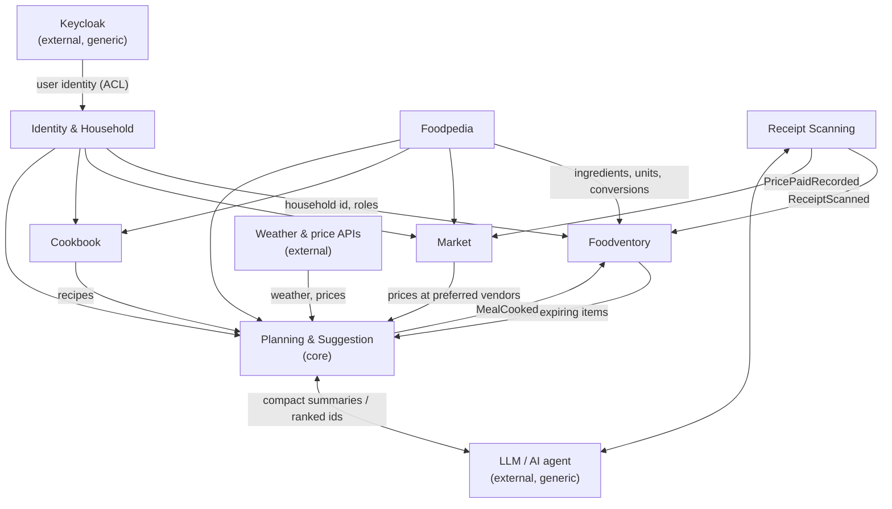

# Context Map

## Bounded contexts

| Context | Responsibility | Type | Phase |
|---|---|---|---|
| **Planning & Suggestion** | Meal plans, budget tracking, AI suggestions, shopping lists | **Core** | After MVP |
| **Foodpedia** | Ingredients, units, conversions, shelf life — shared reference data | Supporting | MVP |
| **Foodventory** | Named pantries, stock items, quantities, expiry, thresholds | Supporting | MVP |
| **Market** | Vendors, products, price observations, preferred vendors | Supporting | After MVP (legacy version exists) |
| **Cookbook** | Recipes, ingredients with quantities, servings, sharing | Supporting | After MVP |
| **Receipt Scanning** | Receipt photo → structured lines → stock and prices | Supporting (AI is an external generic service) | Later |
| **Identity & Household** | Authentication (Keycloak), user profiles, households, memberships, sharing rules ([ADR 0015](../architecture/adr/0015-user-profile.md)) | Generic (auth) + small supporting model | MVP (minimal) |

- **Core** — the differentiator; gets the richest model and most investment.
- **Supporting** — necessary, simpler models.
- **Generic** — reuse off-the-shelf solutions (Keycloak for identity, an LLM for AI).

## Map

## Relationships

| Upstream → Downstream | Pattern | Notes |
|---|---|---|
| Keycloak → Identity & Household | Anti-corruption layer | Only the subject id and roles cross the boundary; no Keycloak types in the domain. |
| Identity & Household → all | Shared identifiers | Contexts reference `HouseholdId` / `UserId` by id only. `UserId` is Cooquoi's own id, independent of the identity provider. |
| Foodpedia → Foodventory, Market, Cookbook, Planning | Open host service | Foodpedia publishes ingredients, units and conversions; downstream contexts reference ingredients by id and never modify them. |
| Foodventory, Market, Cookbook → Planning & Suggestion | Customer / supplier | Planning reads stock, prices and recipes through queries or published events. |
| Receipt Scanning → Foodventory | Published event | `ReceiptScanned`; the Foodventory context restocks its lines as items to put away and publishes its own `ItemsRestocked`. |
| Receipt Scanning → Market | Published event | `PricePaidRecorded` for the prices on the receipt. |
| Planning & Suggestion → Foodventory | Published event | `MealCooked` consumes stock. |
| Planning & Suggestion ↔ LLM | Anti-corruption layer | Domain sends compact summaries and receives ranked ids + explanations (see [ADR 0005](../architecture/adr/0005-ai-suggestions-token-strategy.md)). |

## Rules across contexts

- **Ownership**: every household-owned resource (pantry, budget, preferred vendors, recipes) carries a `HouseholdId` from day one, even while households have a single member.
- **Reference by id**: contexts never share entities; they hold ids of other contexts' aggregates.
- **No direct database access across contexts**: integration goes through queries exposed by the owning context or through domain/integration events.
- **The quantity problem**: recipes, stock and products express quantities differently. Foodpedia's base units and conversions are the common ground that makes them comparable.
