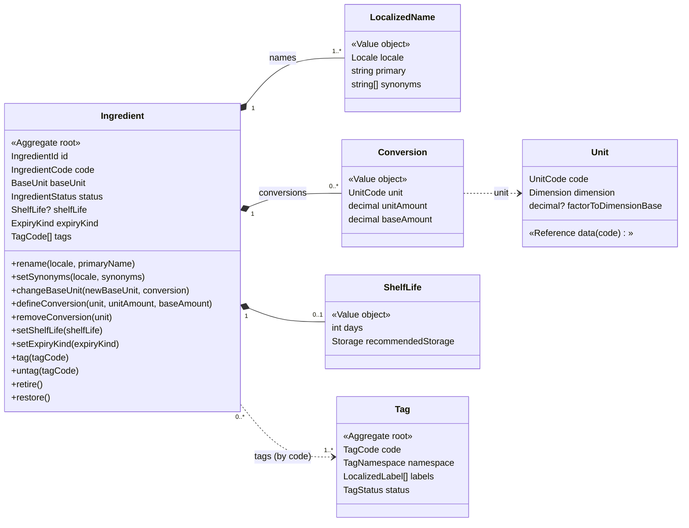

# Foodpedia — Domain model

- **Status**: Reviewed — ready for the spike
- **Type**: Supporting context, upstream of Foodventory, Market, Cookbook and Planning ([context map](../../business/context-map.md))

## Purpose

Foodpedia is the **shared reference knowledge about food**: what an ingredient is, how it is named in each language, how it is classified, in which unit it is measured, how its units convert, and how long and where it keeps. Other contexts reference ingredients **by id** and never modify them.

It answers three questions for the rest of the system:

1. *Which ingredient is this?* — identity, tags and multilingual search.
2. *How much is this, in a comparable unit?* — base unit and conversions.
3. *When should this probably be eaten, and where should it be kept?* — default shelf life and recommended storage.

## Model

### Ingredient (aggregate root)

| Field | Type | Notes |
|---|---|---|
| `id` | `IngredientId` | UUID v7. What other contexts store. |
| `code` | `IngredientCode` | Language-neutral kebab-case slug (`salmon`, `smoked-salmon`, `brown-rice`). Unique, **immutable**. Used in seed files, AI prompts and logs. |
| `names` | `LocalizedName[]` | One per locale; **English required**. |
| `baseUnit` | `BaseUnit` | `gram` \| `millilitre` \| `piece`. Changeable by a curator **only with a conversion between old and new base unit** (see below). |
| `conversions` | `Conversion[]` | Ingredient-specific units → base unit (Foodpedia defaults; households may override in Foodventory). |
| `shelfLife` | `ShelfLife?` | Default days and recommended storage, used to propose expiry dates and storage. |
| `expiryKind` | `printed` \| `estimated` \| `longLife` | How its expiry is known (see *ExpiryKind*). Seeded, set by curators. |
| `tags` | `TagCode[]` | Classification: category, season, diet, allergen, family… At least one `category:` tag. |
| `status` | `active` \| `retired` | Never deleted. Retired ingredients stay readable for existing references, but cannot be newly used. |
| `scope` *(planned)* | `global` \| `household` | Household-private ingredients, after MVP. Not implemented; reserved so identity and uniqueness rules do not change later. |

**Variants are separate ingredients**: *salmon* and *smoked salmon*, *white rice* and *brown rice* each have their own code. A shared `family:` tag (`family:salmon`, `family:rice`) links them for substitution and suggestions.

### Changing the base unit

Early data may have the wrong base unit, so curators can change it:

- The change carries **a conversion between old and new base unit** (e.g. `g` → `piece` with `1 piece = 60 g`), so every quantity expressed in the old base unit stays convertible.
- Existing conversions are recomputed against the new base unit.
- Foodpedia publishes `BaseUnitChanged`. **Foodventory re-normalizes from the entered quantities it always keeps**, so no user data is lost or guessed.

### LocalizedName (value object)

- `locale`: `en` \| `fr` \| `vi` ([ADR 0012](../../architecture/adr/0012-internationalization.md)).
- `primary`: the display name (`Saumon`).
- `synonyms`: alternative names used by search (`courgette` as English synonym of `zucchini`).
- Missing locale → falls back to English.

### Tag (aggregate root)

Tags replace a fixed category list and cover every classification need with **one flexible mechanism**.

| Field | Notes |
|---|---|
| `code` | `<namespace>:<value>`, e.g. `category:meat`, `season:winter`. Unique, immutable. |
| `namespace` | `category` · `season` · `diet` · `allergen` · `family` (fixed list in code; extended by an ADR-free code change). |
| `labels` | Translated labels (`en` required), like ingredient names. |
| `status` | `active` \| `retired`. |

| Namespace | Examples | Used for |
|---|---|---|
| `category` | `category:vegetables`, `category:fish-seafood`, `category:dairy-eggs` | UI grouping, default sort. **At least one per ingredient**; several allowed (tomato: vegetables + fruits). |
| `season` | `season:winter`, `season:summer` | Suggestions. *Caveat:* seasons differ by region (southern Vietnam has wet/dry seasons); may evolve into months per region. |
| `diet` | `diet:vegan`, `diet:vegetarian`, `diet:halal`, `diet:gluten-free` | Filters, suggestions. |
| `allergen` | `allergen:fish`, `allergen:nuts`, `allergen:lactose` | Warnings, suggestions. |
| `family` | `family:salmon`, `family:rice` | Substitutions between variants. |

### Unit (reference data in code)

Units are a **fixed catalogue defined in code**, not data curators edit. Their labels are UI text.

| Dimension | Units (code) | Universal conversion |
|---|---|---|
| `mass` | `g`, `kg` | `kg` = 1000 `g` |
| `volume` | `ml`, `l`, `tsp`, `tbsp`, `cup` | `l` = 1000 `ml`, `tsp` = 5 `ml`, `tbsp` = 15 `ml`, `cup` = **250 `ml` (metric cup)** |
| `count` | `piece` | — |
| `custom` | `pack`, `can`, `bottle`, `slice`, `fillet`, `clove`, `bunch`, `pinch`… | **None** — only through a conversion |

A US cup (240 ml), if needed later, is a separate unit (`us-cup`).

### Conversion (value object)

A conversion is a **ratio**: "`unitAmount` `<unit>` = `baseAmount` of the ingredient's base unit". Storing both sides keeps values exact.

| Ingredient (base unit) | Conversions |
|---|---|
| Salmon (`g`) | 1 `fillet` = 200 `g` · 1 `piece` = 200 `g` |
| Garlic (`g`) | 1 `clove` = 5 `g` · 1 `piece` (head) = 50 `g` |
| Egg (`piece`) | 60 `g` = 1 `piece` |
| Milk (`ml`) | 1030 `g` = 1000 `ml` |
| Rice (`g`) | 1 `cup` = 185 `g` |

**Rule:** a conversion exists only for a unit that **cannot** be reached from the base unit by a universal conversion. A conversion to `g` also unlocks `kg`; one to `ml` unlocks `l`, `tsp`, `tbsp`, `cup`.

**Household conversions** (a household confirming "1 fillet ≈ 180 g" for *its* salmon) belong to **Foodventory**, not Foodpedia: they vary by household and region. Foodpedia conversions are the shared defaults.

### ShelfLife (value object)

- `days`: default number of days the ingredient keeps.
- `recommendedStorage`: `fridge` \| `freezer` \| `room`.
- Used by Foodventory to propose an expiry date and a pantry; always adjustable by the user.

### ExpiryKind (enum)

How the Foodventory context should treat an ingredient's expiry date:

| Kind | Examples | Meaning |
|---|---|---|
| `printed` | Milk, yoghurt, packaged meat, eggs, cheese | The date is on the package and differs every time: never proposed, the user types it. |
| `estimated` | Vegetables, fruit, bread, leftovers | No printed date: proposed from shelf life (or the household's remembered value). |
| `longLife` | Rice, pasta, cans | Keeps for months: expiry optional, never warned. |

Households may override the kind for their own stock in the Foodventory context.

## Invariants

| # | Rule |
|---|---|
| F1 | Ingredient and tag `code`s are unique and immutable. |
| F2 | An English name (ingredient) / label (tag) exists. |
| F3 | At most one `LocalizedName` per locale. |
| F4 | A **primary** name is unique per locale among active ingredients (synonyms may overlap: "pepper"). |
| F5 | A base-unit change must include a valid conversion between the old and the new base unit. |
| F6 | A conversion's `unitAmount` and `baseAmount` are > 0. |
| F7 | At most one conversion per unit; no conversion for a unit universally convertible to the base unit (including the base unit itself). |
| F8 | `shelfLife.days` is > 0 and ≤ 36500 (100 years) when set. |
| F9 | An ingredient has at least one active `category:` tag; it may only use active tags. |
| F10 | A retired ingredient or tag cannot be modified, except to be restored. Nothing is ever hard-deleted. |
| F11 | Only users with the `catalog-curator` role change Foodpedia. Changes apply immediately. |
| F12 | Every ingredient has an `expiryKind`. |

## Domain services (published to other contexts)

| Service | Purpose |
|---|---|
| `QuantityConverter.Normalize(ingredientId, quantity)` | Converts `(amount, unit)` to the base unit using **Foodpedia defaults**: a universal conversion to the unit of an ingredient conversion (e.g. `kg` → `g`), then the ratio. Returns *unnormalized* when no path exists. Foodventory applies household conversions **before** calling it. |
| `ShelfLifePolicy.Propose(ingredientId, from)` | Proposed expiry (`from + days`) and recommended storage, or none. |

Exposed **in-process** as Foodpedia's published query API ([ADR 0010](../../architecture/adr/0010-modular-monolith-persistence.md)) — other contexts never read Foodpedia's tables.

## Domain events

| Event | When | Consumers |
|---|---|---|
| `IngredientCreated` | Curator adds an ingredient | Search projection |
| `IngredientNamesChanged` | Names or synonyms change | Search projection |
| `IngredientTagsChanged` | Tags added or removed | Search projection, Planning (filters) |
| `BaseUnitChanged` | Base unit changed | **Foodventory, Cookbook, Market** (re-normalize from entered quantities) |
| `ConversionDefined` / `ConversionRemoved` | Default conversion changed | Foodventory (re-normalize unnormalized items) |
| `ShelfLifeChanged` | Shelf life changed | — (affects new proposals only) |
| `IngredientExpiryKindChanged` | Expiry kind changed | Foodventory context (flags and warnings; dates untouched) |
| `IngredientRetired` / `IngredientRestored` | Status change | Foodventory, Cookbook (flag references) |
| `TagCreated` / `TagLabelsChanged` / `TagRetired` | Tag catalogue changes | Search projection |

Events also form the **change history** of Foodpedia (who changed what, when).

## Persistence notes

- Schema `foodpedia`; `ingredients` and `tags` tables; names, conversions and shelf life as owned/JSON columns or child tables (decided in the spike).
- Search: an `ingredient_search_terms` projection (one row per name, synonym and locale) with `pg_trgm` + `unaccent` indexes ([ADR 0012](../../architecture/adr/0012-internationalization.md)).

## Seed data

- **One-shot import**, not a runtime dependency: a script pulls candidate ingredients with names in `en`, `fr`, `vi` from **Wikidata** (CC0 — no licence obligations), maps them to our model, and writes seed files keyed by `code`.
- Base units, conversions, shelf life, expiry kind and tags are not in open sources: they are **proposed by AI and reviewed by the curator** before the seed files are committed.
- Open Food Facts was considered; its ODbL licence requires sharing derived databases under the same licence, so it is used at most as a manual reference.
- Target: ≈200–300 common ingredients for the MVP.
- Seeding is idempotent (by `code`), run at startup in development and once per release in production.

## Decided (2026-11-21)

| Question | Decision |
|---|---|
| Base unit | Changeable by curators, with a conversion; Foodventory re-normalizes from entered quantities |
| Shelf life | Days + recommended storage |
| Household conversions | In Foodventory, per household, applied before Foodpedia defaults |
| Cooking units | `tsp`, `tbsp`, metric `cup` (250 ml) included |
| Categories | Replaced by namespaced **tags** (`category`, `season`, `diet`, `allergen`, `family`) |
| Variants | Separate ingredients, linked by `family:` tags |
| Seed | One-shot import from Wikidata, AI-completed, curator-reviewed |
| Curator edits | Applied immediately; events give history. Draft/publish only if several or external curators appear |
| Deletion | Never; retire only |
| Expiry kind | `printed` \| `estimated` \| `longLife` on every ingredient, seeded (AI-proposed, curator-reviewed) and set by curators; own event `IngredientExpiryKindChanged` (2026-11-22) |
