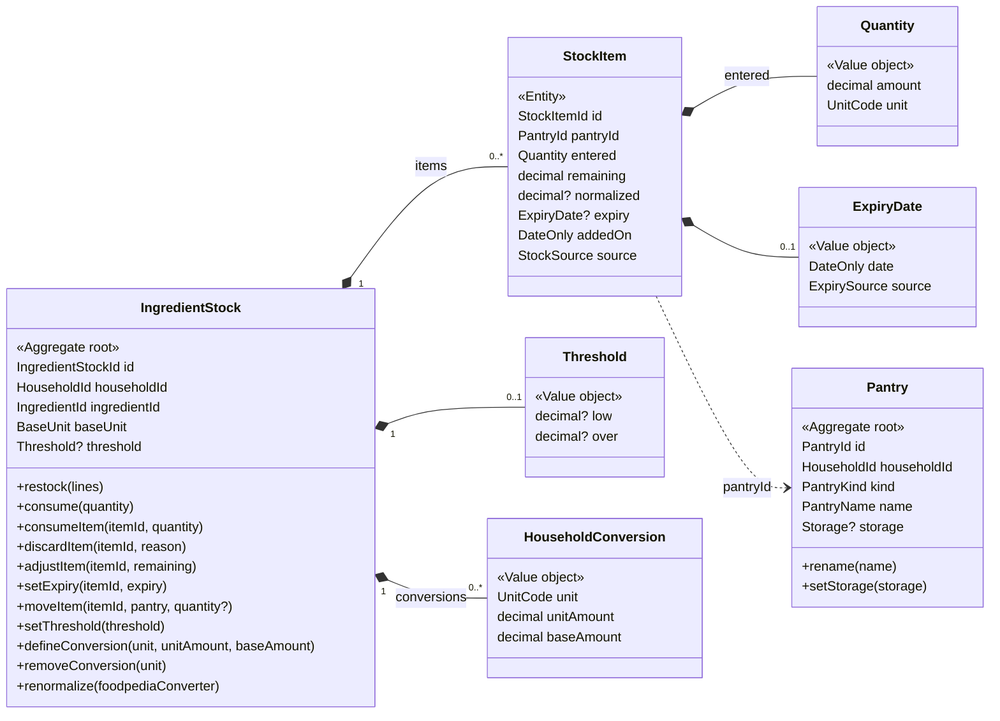

# Pantry — Domain model

- **Status**: Reviewed — decisions of 2026-11-22 applied
- **Type**: Supporting context, downstream of Foodpedia and Identity & Household, supplier of Planning & Suggestion ([context map](../../business/context-map.md))

## Purpose

Pantry is **what a household has in stock**: in which named pantries, how much, and until when. Its first customer is the suggestion engine (Planning & Suggestion, the core domain), which ranks recipes by stock coverage and expiring items ([ADR 0005](../../architecture/adr/0005-ai-suggestions-token-strategy.md)).

It answers three questions for the rest of the system:

1. *What do we have, and where?* — pantries and stock items.
2. *How much of each ingredient, in a comparable unit?* — entered quantities normalized to the Foodpedia base unit, household conversions first.
3. *What must be eaten soon, and what is running low?* — expiry dates (defaulted from Foodpedia shelf life) and thresholds.

Input is **API-first**: manual restock in MVP; receipt or product scan later (Receipt Scanning publishes `ReceiptScanned`, which Pantry turns into a restock). **Every restock lands in the inbox pantry** ("To put away"); putting items away into a real pantry is a separate step. Cooking consumes stock when Planning publishes `MealCooked`. Pantry holds **no prices** (Market records `PricePaidRecorded`).

## Model

### Aggregate boundaries

Two aggregates, both owned by a `HouseholdId`:

- **Pantry** — the named storage ("Fridge", "Freezer", "Mum's cellar"), or the household's **inbox**. Small, rarely changed.
- **IngredientStock** — everything one household holds of **one ingredient**, across all its pantries (inbox included): the stock items, the threshold and the household conversions. One per `(householdId, ingredientId)`, created on first restock, threshold or conversion.

Why `IngredientStock` and not one `Pantry` aggregate holding every item, nor `StockItem` as its own aggregate:

| Option | Concurrency | Invariants |
|---|---|---|
| Pantry holds its items | One ETag for the whole fridge: a receipt import, a cooked meal and a manual edit all conflict. Items of one ingredient spread over several pantries; every put-away would span two aggregates. | Thresholds and totals are per ingredient, not per pantry — they would span aggregates. |
| StockItem alone | No conflicts, but none where they matter either: two concurrent consumptions of the same ingredient can both take the same item. | Consumption across items, totals, thresholds, low-stock transitions, splits and re-normalization after a conversion all span aggregates. |
| **IngredientStock** (chosen) | Conflicts only between writes on the **same ingredient** of the same household — exactly where they must be serialized. | Every rule except pantry naming and the inbox is local: totals, consumption order (P8), splits (P10), thresholds (P13), conversions and re-normalization (P7). |

A cooked meal or a receipt touches several ingredients, so one command may change several `IngredientStock`s in **one transaction** (same context, same database — [ADR 0010](../../architecture/adr/0010-modular-monolith-persistence.md)); a concurrency conflict retries the whole message.

### Pantry (aggregate root)

| Field | Type | Notes |
|---|---|---|
| `id` | `PantryId` | UUID v7. |
| `householdId` | `HouseholdId` | Owner ([context map, Ownership](../../business/context-map.md#rules-across-contexts)). |
| `kind` | `inbox` \| `regular` | Exactly one `inbox` per household (P3). |
| `name` | `PantryName` | Trimmed, 1–60 chars, unique per household (P1). |
| `storage` | `fridge` \| `freezer` \| `room` \| none | Same values as Foodpedia's recommended storage; drives proposed expiry on put-away. Always none for the inbox. |

**Default pantries**, created when `HouseholdCreated` is received, named in the creator's language (fallback English):

| Name (en) | Kind | Storage |
|---|---|---|
| To put away | `inbox` | none |
| Fridge | `regular` | `fridge` |
| Freezer | `regular` | `freezer` |
| Cupboard | `regular` | `room` |

The inbox is a system pantry: it cannot be renamed, given a storage, deleted, or chosen as a move target (P3). Clients may display it with a translated label by `kind`.

### IngredientStock (aggregate root)

| Field | Type | Notes |
|---|---|---|
| `id` | `IngredientStockId` | UUID v7. |
| `householdId`, `ingredientId` | ids | Unique together. The ingredient is referenced by id only. |
| `baseUnit` | `BaseUnit` | Copied from Foodpedia; updated on `BaseUnitChanged`. |
| `items` | `StockItem[]` | Items currently held (remaining > 0). Depleted or discarded items leave the aggregate; events keep the history. |
| `conversions` | `HouseholdConversion[]` | The household's own ratios for this ingredient, applied before Foodpedia defaults. |
| `threshold` | `Threshold?` | Low and over levels in the base unit. |

**Total** = sum of `normalized` over normalized items in **every** pantry, the inbox included: items not yet put away are still stock. Unnormalized items are listed beside the total, never added to it.

### StockItem (entity)

| Field | Notes |
|---|---|
| `pantryId` | Where it is: the inbox after restock, then wherever it was put away. Changes only by a move. |
| `entered` | **Entered quantity** as typed (`2 pack`). Never overwritten (P5). |
| `remaining` | What is left, **in the entered unit** (`1.5 pack`). Consumption, adjustment and splitting change only this. |
| `normalized` | `remaining` in the base unit, or none when **unnormalized**. Derived, stored for queries, recomputed whenever a conversion or the base unit changes (P7). |
| `expiry` | `ExpiryDate?` with its source: `proposed` (from shelf life) or `manual`. |
| `addedOn` | Restock date; tie-breaker for consumption order; kept by splits. |
| `source` | `manual` \| `receipt` (+ source reference for idempotency, P15); kept by splits. |

Keeping `remaining` in the entered unit means re-normalization is always exact: Pantry recomputes from the user's own unit and never stores a converted value it cannot reproduce.

### Quantity (value object)

`amount` (decimal, > 0, at most 3 decimals) and `unit` (a code from Foodpedia's unit catalogue, custom units included). Fractions are allowed in every unit (`0.5 piece` onion, `1.5 pack`).

### Normalization

For a quantity of an ingredient, in this order:

1. Unit **is** the base unit, or universally convertible to it (`kg` → `g`) → universal factor.
2. A **household conversion** for the unit → its ratio (possibly through a universal step: `cup` with a household `ml` conversion).
3. Foodpedia `NormalizeQuantity` (published API P2) → default conversion.
4. Otherwise → **unnormalized**. Never guessed.

When an unknown unit is restocked, the restock response carries a **conversion proposal** for the client to show (MVP: the Foodpedia default if any, otherwise none; AI proposals later). Confirming it is a separate command (*define household conversion*).

A **consumption** or **split** in a unit with no path is rejected with `pantry.unit-not-convertible`; its details name the ingredient and unit and invite the client to define a household conversion and retry. Using an item's exact entered unit never needs a conversion.

### Expiry defaults

- **At restock** (into the inbox), an item without an explicit expiry gets `ShelfLifePolicy.Propose(ingredientId, addedOn)` (Foodpedia P3) as a `proposed` expiry: the inbox has no storage, so the proposal assumes the ingredient's **recommended storage**.
- **On put-away**, a `proposed` expiry is recomputed for the target: kept (from `addedOn`) when the target storage is unset or equals the recommended storage, **dropped** otherwise (salmon put in the freezer) — the user may set one.
- A `manual` expiry is never touched by restock, put-away or later Foodpedia changes.
- No shelf life → no proposed expiry. Changing Foodpedia shelf life later never touches existing items.

For put-away, the read side offers a **suggested pantry** per inbox item: the household's first regular pantry whose storage matches the recommended storage, else none.

### Threshold (value object)

`low` and `over`, each optional, in the base unit, per household and ingredient. **Low stock** when total < low; **overstock** when total > over. Compared on the total of all pantries, inbox included (P13).

## Invariants

| # | Rule |
|---|---|
| P1 | A pantry name is 1–60 chars after trimming and unique within its household (case- and accent-insensitive). |
| P2 | Every pantry and ingredient stock belongs to one household; a stock item is only placed in, or moved to, a pantry of the same household. Callers act only on their own household. |
| P3 | A household has exactly one **inbox** pantry, created with the household. It has no storage and cannot be renamed, deleted or chosen as a move target. |
| P4 | Every restock lands in the inbox and requires an **active** Foodpedia ingredient. Items of an ingredient retired later stay, flagged. |
| P5 | An entered quantity has amount > 0 and a known unit, and never changes after restock. |
| P6 | `remaining` is ≥ 0 and never negative; an item reaching 0 is depleted and leaves the aggregate. |
| P7 | `normalized` follows the normalization order above; no path → unnormalized. Re-normalization is triggered by household conversion changes, Foodpedia `ConversionDefined` / `ConversionRemoved` and `BaseUnitChanged`. |
| P8 | Consuming by ingredient takes from items **earliest expiry first** (no expiry last), oldest `addedOn` as tie-breaker. A quantity with no conversion path is rejected (`pantry.unit-not-convertible`), except on an item in its exact entered unit. A quantity beyond what is held consumes everything and reports the **shortfall** (manual and `MealCooked` alike). |
| P9 | Expiry is optional and follows *Expiry defaults*: proposed at restock from the recommended storage, recomputed or dropped on put-away; a manual expiry replaces a proposed one and is never changed by the system. A past date is allowed (the item is *expired*). |
| P10 | A move (put-away) targets a regular pantry. Without a quantity it moves the whole item; with one (> 0, ≤ remaining, in a unit convertible to the entered unit) it **splits** the item: the new item has the moved quantity in the entered unit and keeps `source` and `addedOn`; its expiry follows P9 for the target. A quantity equal to remaining is a whole move. |
| P11 | A threshold's `low` and `over` are ≥ 0 when set, and `over` > `low` when both are set. |
| P12 | A household conversion has `unitAmount` and `baseAmount` > 0, at most one per unit, and none for a unit universally convertible to the base unit (as Foodpedia F7). |
| P13 | Low stock / overstock are evaluated on the normalized total, inbox included; `StockRunningLow` / `StockOverstocked` are raised only when the state **changes**. |
| P14 | Only a regular pantry can be deleted, and only when it holds no stock item and is not the household's last regular pantry. |
| P15 | A restock or consumption coming from an event (receipt line, cooked meal) is applied once per source reference. |

Errors (`ProblemDetails` codes): `pantry.name-taken` (Conflict), `pantry.inbox-protected`, `pantry.not-empty`, `pantry.last-pantry`, `pantry.ingredient-retired`, `pantry.unit-not-convertible`, `pantry.quantity-exceeds-remaining`, `pantry.invalid-threshold`, `pantry.conversion-not-needed` (BusinessRule), not found through the common code.

## Domain services

| Service | Purpose |
|---|---|
| `StockNormalizer` | Applies the normalization order: universal factors and household conversions locally, then Foodpedia `NormalizeQuantity`. Used by restock, consumption, splits and re-normalization. |
| `ExpiryProposer` | Foodpedia `ProposeShelfLife` + storage check for put-away (P9). |
| `ExpiryWatch` *(scheduled, daily)* | Raises `StockItemExpiringSoon` once per item entering the warning window (context config, default 3 days). |

Foodpedia is called **in-process** through its published API; Pantry never reads Foodpedia tables.

## Domain events

| Event | When | Consumers |
|---|---|---|
| `PantryCreated` / `PantryRenamed` / `PantryStorageChanged` / `PantryDeleted` | Pantry lifecycle | — |
| `ItemsRestocked` | Every restock into the inbox (manual or receipt), with its items | Planning (suggestion cache) |
| `StockItemMoved` | Put-away or move between pantries; carries from/to pantry, quantity and the new item id when split | Planning (cache) |
| `StockItemConsumed` | Remaining decreased by consumption (amount, shortfall) | Planning (cache) |
| `StockItemDiscarded` | Item removed unconsumed (reason: expired, spoiled, other) | Later: waste statistics |
| `StockItemAdjusted` / `StockItemExpiryChanged` | Corrections | Planning (cache) |
| `StockItemExpiringSoon` | Item enters the warning window | Planning (suggestions), notifications later |
| `StockRunningLow` / `StockOverstocked` | Threshold state changes (P13) | Planning (shopping list) |
| `HouseholdConversionDefined` / `HouseholdConversionRemoved` | Household conversion changed | — |

Consumed: `HouseholdCreated` (Identity), `BaseUnitChanged`, `ConversionDefined`, `ConversionRemoved`, `IngredientRetired` / `IngredientRestored` (Foodpedia), `ReceiptScanned` (Receipt Scanning, later), `MealCooked` (Planning, later).

## Persistence notes

- Schema `pantry`; tables `pantries` (with `kind`; partial unique index: one `inbox` per household), `ingredient_stocks` (unique `household_id, ingredient_id`), `stock_items` (child of ingredient stock, with `pantry_id`, `normalized_amount`, `expires_on`), household conversions and threshold as owned/JSON columns.
- Indexes for the read side: `stock_items (household_id, expires_on)`, `(household_id, pantry_id)`.
- Optimistic concurrency (version / ETag) on both aggregates.
- Idempotency of event-driven commands (P15) through Wolverine's inbox plus the source reference stored on the item / consumption.

## Decided (2026-11-22)

| Question | Decision |
|---|---|
| Aggregates | `Pantry` + `IngredientStock` per household and ingredient; `StockItem` is an entity |
| Quantities | Entered kept forever; remaining in the entered unit; normalized derived |
| Household conversions | Inside `IngredientStock`, applied before Foodpedia defaults |
| Prices | Not in Pantry (Market) |
| Inbox pantry | Every restock lands in "To put away"; it counts as stock; not renamable, not deletable, not a move target |
| Default pantries | To put away, Fridge, Freezer, Cupboard, created on `HouseholdCreated` in the creator's language |
| Consumption order | Earliest expiry first, oldest added as tie-breaker |
| Consuming more than held | Clamp to zero and report the shortfall (manual and `MealCooked`) |
| Unit with no conversion path | Reject with `pantry.unit-not-convertible`, inviting a household conversion and retry; the exact entered unit always works |
| Expiry warning window | Query parameter `withinDays` (default 3); same default in config for `StockItemExpiringSoon`; household setting later |
| Thresholds | Per household and ingredient |
| Storage mismatch on put-away | Proposed expiry dropped — *default, revisit* (storage factors in Foodpedia later) |
| Restock events | Pantry owns `ItemsRestocked`; Receipt Scanning publishes `ReceiptScanned`; moves publish `StockItemMoved` |
| Move / put-away | Optional quantity: absent = whole item, present = split |
