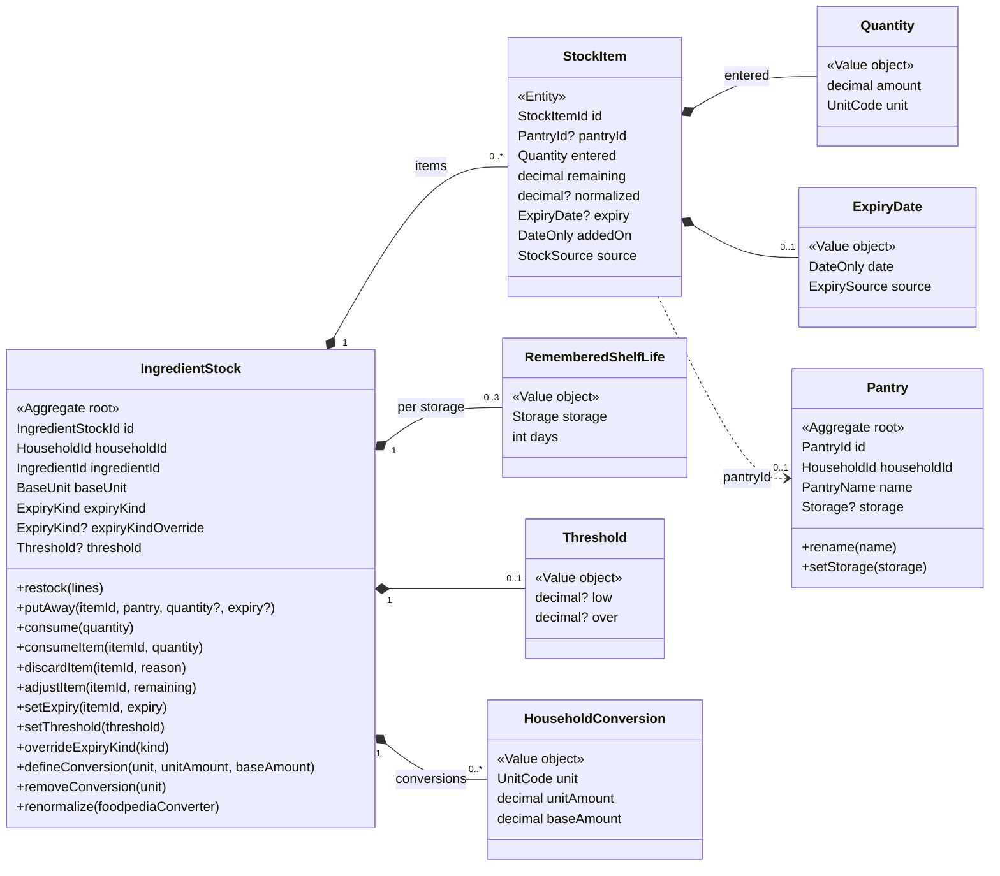

# Pantry context — Domain model

- **Status**: Reviewed — decisions of 2026-11-22 applied
- **Type**: Supporting context, downstream of the Foodpedia context and Identity & Household, supplier of Planning & Suggestion ([context map](../../business/context-map.md))

## Purpose

The Pantry context is **what a household has in stock**: in which named pantries, how much, and until when. Its first customer is the suggestion engine (Planning & Suggestion, the core domain), which ranks recipes by stock coverage and expiring items ([ADR 0005](../../architecture/adr/0005-ai-suggestions-token-strategy.md)).

It answers three questions for the rest of the system:

1. *What do we have, and where?* — Pantry aggregates and stock items; items not yet put away have no pantry.
2. *How much of each ingredient, in a comparable unit?* — entered quantities normalized to the Foodpedia base unit, household conversions first.
3. *What must be eaten soon, and what is running low?* — expiry dates (by expiry kind, learned or defaulted from Foodpedia shelf life) and thresholds.

Input is **API-first**: manual restock in MVP; receipt or product scan later (Receipt Scanning publishes `ReceiptScanned`, which the Pantry context turns into a restock). **Every restock creates stock items with no pantry** ("to put away"); putting them away into a Pantry aggregate is a separate step. Cooking consumes stock when Planning publishes `MealCooked`. The Pantry context holds **no prices** (Market records `PricePaidRecorded`).

## Model

### Aggregate boundaries

Two aggregates, both owned by a `HouseholdId`:

- **Pantry aggregate** — a named storage ("Fridge", "Freezer", "Mum's cellar"). Small, rarely changed.
- **IngredientStock aggregate** — everything one household holds of **one ingredient**, put away or not: the stock items, the threshold, the household conversions, the expiry-kind override and the remembered shelf lives. One per `(householdId, ingredientId)`, created on first restock, threshold, conversion or override.

Why `IngredientStock` and not a Pantry aggregate holding every item, nor `StockItem` as its own aggregate:

| Option | Concurrency | Invariants |
|---|---|---|
| Pantry aggregate holds its items | One ETag for the whole fridge: a receipt import, a cooked meal and a manual edit all conflict. Items of one ingredient spread over several pantries; items not yet put away belong to none; every put-away would span aggregates. | Thresholds, totals and remembered shelf lives are per ingredient, not per pantry — they would span aggregates. |
| StockItem alone | No conflicts, but none where they matter either: two concurrent consumptions of the same ingredient can both take the same item. | Consumption across items, totals, thresholds, low-stock transitions, splits, learning shelf life and re-normalization all span aggregates. |
| **IngredientStock** (chosen) | Conflicts only between writes on the **same ingredient** of the same household — exactly where they must be serialized. | Every rule except pantry naming and deletion is local: totals, consumption order (P7), put-away and splits (P9), thresholds (P12), learned shelf life (P15), conversions and re-normalization (P6). |

A cooked meal or a receipt touches several ingredients, so one command may change several `IngredientStock`s in **one transaction** (same context, same database — [ADR 0010](../../architecture/adr/0010-modular-monolith-persistence.md)); a concurrency conflict retries the whole message.

### Pantry (aggregate root)

| Field | Type | Notes |
|---|---|---|
| `id` | `PantryId` | UUID v7. |
| `householdId` | `HouseholdId` | Owner ([context map, Ownership](../../business/context-map.md#rules-across-contexts)). |
| `name` | `PantryName` | Trimmed, 1–60 chars, unique per household (P1). |
| `storage` | `fridge` \| `freezer` \| `room` \| none | Same values as Foodpedia's recommended storage; drives proposed expiry on put-away. |

**Default Pantry aggregates**, created when `HouseholdCreated` is received, named in the creator's language (fallback English): **Fridge** (`fridge`), **Freezer** (`freezer`), **Cupboard** (`room`).

A household may delete all its Pantry aggregates: items with no pantry stay valid stock, so no "keep at least one pantry" rule is needed; put-away just waits until one exists.

### IngredientStock (aggregate root)

| Field | Type | Notes |
|---|---|---|
| `id` | `IngredientStockId` | UUID v7. |
| `householdId`, `ingredientId` | ids | Unique together. The ingredient is referenced by id only. |
| `baseUnit` | `BaseUnit` | Copied from the Foodpedia context; updated on `BaseUnitChanged`. |
| `expiryKind` | `ExpiryKind` | Copied from the Foodpedia Ingredient aggregate; updated on `IngredientExpiryKindChanged`. |
| `expiryKindOverride` | `ExpiryKind?` | The household's own kind ("our bread is printed-date bakery bread"). **Effective kind** = override ?? `expiryKind`. |
| `rememberedShelfLives` | `RememberedShelfLife[]` | For an effective kind `estimated` only: days per storage, learned at put-away (P15). |
| `items` | `StockItem[]` | Items currently held (remaining > 0). Depleted or discarded items leave the aggregate; events keep the history. |
| `conversions` | `HouseholdConversion[]` | The household's own ratios for this ingredient, applied before Foodpedia defaults. |
| `threshold` | `Threshold?` | Low and over levels in the base unit. |

**Total** = sum of `normalized` over normalized items, **put away or not**: items with no pantry are still stock. Unnormalized items are listed beside the total, never added to it.

### StockItem (entity)

| Field | Notes |
|---|---|
| `pantryId` | Where it is. **None after restock** ("to put away"); set by put-away; moves between Pantry aggregates afterwards; never set back to none. |
| `entered` | **Entered quantity** as typed (`2 pack`). Never overwritten (P4). |
| `remaining` | What is left, **in the entered unit** (`1.5 pack`). Consumption, adjustment and splitting change only this. |
| `normalized` | `remaining` in the base unit, or none when **unnormalized**. Derived, stored for queries, recomputed whenever a conversion or the base unit changes (P6). |
| `expiry` | `ExpiryDate?` with its source: `proposed` (by the system) or `manual` (typed by the user). |
| `addedOn` | Restock date; tie-breaker for consumption order; kept by splits; start of learned shelf life. |
| `source` | `manual` \| `receipt` (+ source reference for idempotency, P14); kept by splits. |

A stock item's **storage** is its Pantry aggregate's storage, or none when it has no pantry (or the pantry has none).

Keeping `remaining` in the entered unit means re-normalization is always exact: the Pantry context recomputes from the user's own unit and never stores a converted value it cannot reproduce.

### Quantity (value object)

`amount` (decimal, > 0, at most 3 decimals) and `unit` (a code from Foodpedia's unit catalogue, custom units included). Fractions are allowed in every unit (`0.5 piece` onion, `1.5 pack`).

### Normalization

For a quantity of an ingredient, in this order:

1. Unit **is** the base unit, or universally convertible to it (`kg` → `g`) → universal factor.
2. A **household conversion** for the unit → its ratio (possibly through a universal step: `cup` with a household `ml` conversion).
3. Foodpedia `NormalizeQuantity` (published API P2) → default conversion.
4. Otherwise → **unnormalized**. Never guessed.

When an unknown unit is restocked, the restock response carries a **conversion proposal** for the client to show (MVP: the Foodpedia default if any, otherwise none; AI proposals later). Confirming it is a separate command (*define household conversion*).

A **consumption** or **split** in a unit with no path is rejected with `pantry.unit-not-convertible`; its details name the ingredient and unit and invite the client to define a household conversion and retry. Using an item's exact entered unit never needs a conversion.

### Expiry

Expiry is **always optional, for every kind**; the user can set or change it at any time (*set expiry*). What the system proposes depends on the **effective expiry kind** (Foodpedia `printed` \| `estimated` \| `long-life`, or the household override) and the item's storage:

| Effective kind | At restock / put-away, no date given | Date typed by the user | Warnings, flags |
|---|---|---|---|
| `printed` (milk, yoghurt, packaged meat) | Never pre-filled; the client asks, the user may skip. | `manual`; never learned. | Flagged **missing expiry** while none. |
| `estimated` (vegetables, bread, leftovers) | `proposed` = `addedOn` + remembered days for the storage; else the Foodpedia shelf life when the storage is none or equals the recommended storage; else none. | `manual`; at put-away into a Pantry aggregate with a storage, updates the remembered days for that storage (P15). | Flagged **missing expiry** while none. |
| `long-life` (rice, pasta, cans) | None. | `manual`. | Never warned, never flagged. |

- At restock the storage is none, so an `estimated` item gets the Foodpedia default (recommended storage assumed).
- On put-away, a `proposed` expiry is **recomputed** for the target storage by the table above (possibly dropped: salmon in the freezer with no remembered value). A `manual` expiry is never touched by restock, put-away or later Foodpedia changes.
- A typed date far outside the household's usual range is **accepted**; the put-away response and the read model may carry a hint (`expiryUnusual`), never a rejection.
- Changing Foodpedia shelf life or kind later never rewrites existing expiry dates; a kind change only changes flags and warnings.

For put-away, the read side offers a **suggested pantry** per item with no pantry: the household's first Pantry aggregate whose storage matches the recommended storage, else none.

### RememberedShelfLife (value object)

`storage` (`fridge` \| `freezer` \| `room`) and `days` (> 0): the household's own "this keeps N days in the fridge", from the last manual expiry typed at put-away. One per storage. Kept but unused while the effective kind is not `estimated`.

### Threshold (value object)

`low` and `over`, each optional, in the base unit, per household and ingredient. **Low stock** when total < low; **overstock** when total > over. Compared on the total, items with no pantry included (P12).

## Invariants

| # | Rule |
|---|---|
| P1 | A pantry name is 1–60 chars after trimming and unique within its household (case- and accent-insensitive). |
| P2 | Every Pantry and IngredientStock aggregate belongs to one household; a stock item is only put in a Pantry aggregate of the same household. Callers act only on their own household. |
| P3 | Every restock creates stock items **with no pantry** and requires an **active** Foodpedia ingredient. Items of an ingredient retired later stay, flagged. |
| P4 | An entered quantity has amount > 0 and a known unit, and never changes after restock. |
| P5 | `remaining` is ≥ 0 and never negative; an item reaching 0 is depleted and leaves the aggregate. |
| P6 | `normalized` follows the normalization order above; no path → unnormalized. Re-normalization is triggered by household conversion changes, Foodpedia `ConversionDefined` / `ConversionRemoved` and `BaseUnitChanged`. |
| P7 | Consuming by ingredient takes from items **earliest expiry first** (no expiry last), oldest `addedOn` as tie-breaker, with or without a pantry. A quantity with no conversion path is rejected (`pantry.unit-not-convertible`), except on an item in its exact entered unit. A quantity beyond what is held consumes everything and reports the **shortfall** (manual and `MealCooked` alike). |
| P8 | Expiry is optional for every kind and follows *Expiry*: `printed` is never proposed, `estimated` is proposed (remembered, else Foodpedia default when storage matches), `long-life` is never warned. A manual expiry replaces a proposed one and is never changed by the system. A past date is allowed (the item is *expired*). |
| P9 | Put-away / move sets a Pantry aggregate on an item; there is no move back to no pantry. Without a quantity it moves the whole item; with one (> 0, ≤ remaining, in a unit convertible to the entered unit) it **splits** the item: the new item has the moved quantity in the entered unit and keeps `source` and `addedOn`. The moved item's expiry follows P8 for the target. A quantity equal to remaining is a whole move. |
| P10 | A threshold's `low` and `over` are ≥ 0 when set, and `over` > `low` when both are set. |
| P11 | A household conversion has `unitAmount` and `baseAmount` > 0, at most one per unit, and none for a unit universally convertible to the base unit (as Foodpedia F7). |
| P12 | Low stock / overstock are evaluated on the normalized total, items with no pantry included; `StockRunningLow` / `StockOverstocked` are raised only when the state **changes**. |
| P13 | A Pantry aggregate can be deleted only when it holds no stock item. |
| P14 | A restock or consumption coming from an event (receipt line, cooked meal) is applied once per source reference. |
| P15 | A remembered shelf life is learned only for effective kind `estimated`, from a manual expiry typed at put-away into a Pantry aggregate with a storage: `days` = expiry − `addedOn`, kept only when > 0; one per storage, the last one wins. |

Errors (`ProblemDetails` codes): `pantry.name-taken` (Conflict), `pantry.not-empty`, `pantry.ingredient-retired`, `pantry.unit-not-convertible`, `pantry.quantity-exceeds-remaining`, `pantry.invalid-threshold`, `pantry.conversion-not-needed` (BusinessRule), not found through the common code.

## Domain services

| Service | Purpose |
|---|---|
| `StockNormalizer` | Applies the normalization order: universal factors and household conversions locally, then Foodpedia `NormalizeQuantity`. Used by restock, consumption, splits and re-normalization. |
| `ExpiryProposer` | Effective kind + remembered shelf life + Foodpedia `ProposeShelfLife` and storage check (P8). |
| `ExpiryWatch` *(scheduled, daily)* | Raises `StockItemExpiringSoon` once per item entering the warning window (context config, default 3 days); never for `long-life`. |

The Foodpedia context is called **in-process** through its published API; the Pantry context never reads Foodpedia tables.

## Domain events

| Event | When | Consumers |
|---|---|---|
| `PantryCreated` / `PantryRenamed` / `PantryStorageChanged` / `PantryDeleted` | Pantry aggregate lifecycle | — |
| `ItemsRestocked` | Every restock (manual or receipt), with its items, all with no pantry | Planning (suggestion cache) |
| `StockItemMoved` | Put-away or move between Pantry aggregates; carries from (none on put-away) / to pantry, quantity, the new item id when split | Planning (cache) |
| `StockItemConsumed` | Remaining decreased by consumption (amount, shortfall) | Planning (cache) |
| `StockItemDiscarded` | Item removed unconsumed (reason: expired, spoiled, other) | Later: waste statistics |
| `StockItemAdjusted` / `StockItemExpiryChanged` | Corrections | Planning (cache) |
| `StockItemExpiringSoon` | Item enters the warning window | Planning (suggestions), notifications later |
| `StockRunningLow` / `StockOverstocked` | Threshold state changes (P12) | Planning (shopping list) |
| `HouseholdConversionDefined` / `HouseholdConversionRemoved` | Household conversion changed | — |
| `ExpiryKindOverridden` / `ShelfLifeRemembered` | Household kind override set or cleared; remembered days learned | — |

Consumed: `HouseholdCreated` (Identity), `BaseUnitChanged`, `ConversionDefined`, `ConversionRemoved`, `IngredientExpiryKindChanged`, `IngredientRetired` / `IngredientRestored` (Foodpedia context), `ReceiptScanned` (Receipt Scanning, later), `MealCooked` (Planning, later).

## Persistence notes

- Schema `pantry`; tables `pantries`, `ingredient_stocks` (unique `household_id, ingredient_id`), `stock_items` (child of ingredient stock, with nullable `pantry_id`, `normalized_amount`, `expires_on`), household conversions, remembered shelf lives and threshold as owned/JSON columns.
- Indexes for the read side: `stock_items (household_id, expires_on)`, `(household_id, pantry_id)` (covers `pantry_id IS NULL`).
- Optimistic concurrency (version / ETag) on both aggregates.
- Idempotency of event-driven commands (P14) through Wolverine's inbox plus the source reference stored on the item / consumption.

## Decided (2026-11-22)

| Question | Decision |
|---|---|
| Aggregates | Pantry aggregate + IngredientStock aggregate per household and ingredient; `StockItem` is an entity |
| Quantities | Entered kept forever; remaining in the entered unit; normalized derived |
| Household conversions | In the IngredientStock aggregate, applied before Foodpedia defaults |
| Prices | Not in the Pantry context (Market) |
| To put away | Not an entity: a stock item with no pantry. Restock always creates such items; put-away sets a Pantry aggregate; no move back. They count as stock (totals, suggestions, thresholds). Clients show them as "To put away" |
| Default Pantry aggregates | Fridge, Freezer, Cupboard, created on `HouseholdCreated` in the creator's language |
| Last pantry | No rule: a household may delete every Pantry aggregate (P13 only requires it empty) |
| Consumption order | Earliest expiry first, oldest added as tie-breaker |
| Consuming more than held | Clamp to zero and report the shortfall (manual and `MealCooked`) |
| Unit with no conversion path | Reject with `pantry.unit-not-convertible`, inviting a household conversion and retry; the exact entered unit always works |
| Expiry kind | From the Foodpedia Ingredient aggregate (`printed` \| `estimated` \| `long-life`), with an optional household override in the IngredientStock aggregate |
| Expiry at restock and put-away | Always optional. `printed`: never pre-filled or learned. `estimated`: remembered per storage, else Foodpedia default when storage matches, else none; a typed date at put-away updates the remembered value. `long-life`: never warned |
| Missing expiry | Flagged (`expiryMissing`) for `printed` / `estimated`; the Planning read model counts it as unknown, never as expiring |
| Unusual expiry | Accepted; a hint at most, no rejection rule |
| Expiry warning window | Query parameter `withinDays` (default 3); same default in config for `StockItemExpiringSoon`; household setting later |
| Thresholds | Per household and ingredient |
| Restock events | The Pantry context owns `ItemsRestocked`; Receipt Scanning publishes `ReceiptScanned`; moves publish `StockItemMoved` |
| Move / put-away | Optional quantity: absent = whole item, present = split |
